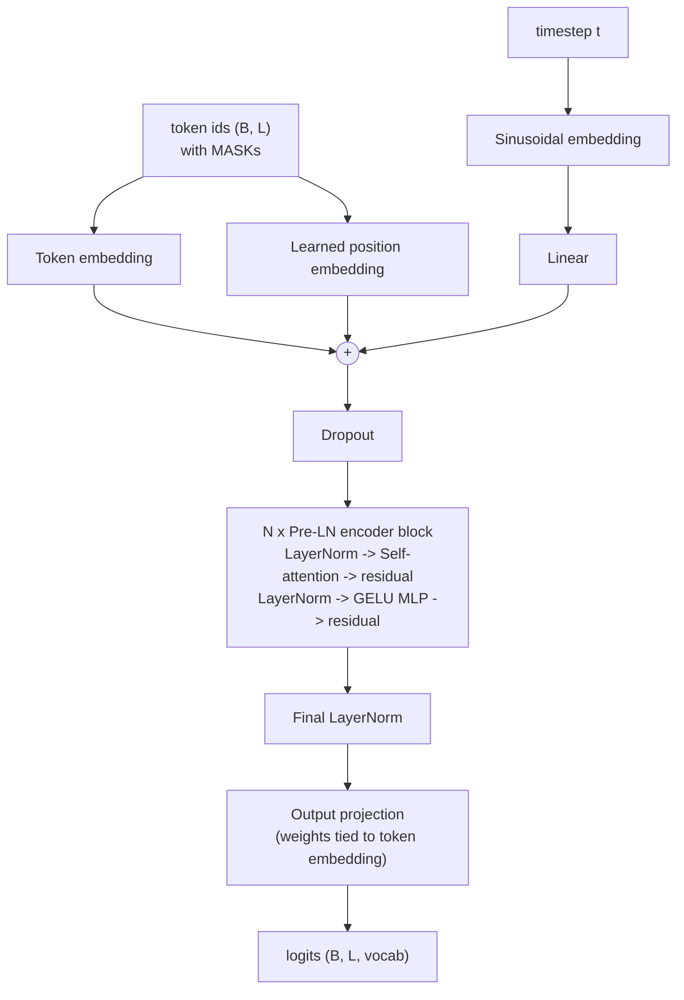
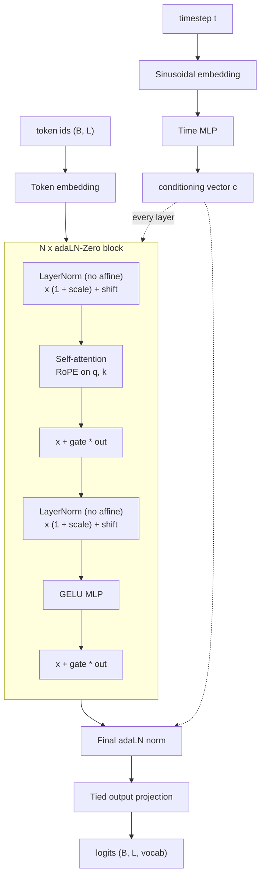
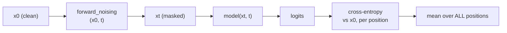
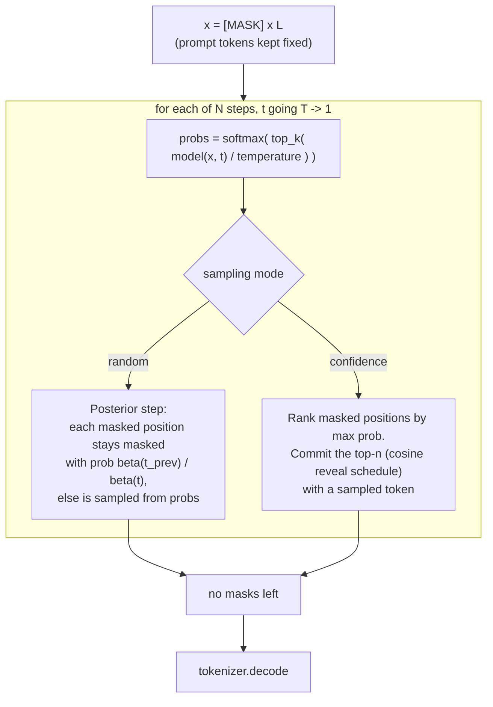

# Masked Diffusion Language Model on TinyStories

A small text generator that does not write left to right. It starts from a sequence of `[MASK]` tokens and fills them in over several passes, the way you might fill in a crossword: easy squares first, then the ones that depend on them.

It is trained on [TinyStories](https://huggingface.co/datasets/roneneldan/TinyStories) and trained entirely on one laptop (Apple M4 Pro, 24 GB, PyTorch MPS backend). This is a learning project. It produces text that sounds like a children's story for a sentence or two and then loses the plot. The [results](#results) and [limitations](#limitations) sections are written to be read before you get excited.

**Contents**
[Why masked diffusion](#why-masked-diffusion-for-text) · [Architecture](#architecture) · [Training setup](#training-setup) · [Results](#results) · [What went wrong along the way](#what-went-wrong-along-the-way) · [Limitations](#limitations) · [Where this could go](#where-this-could-go) · [Usage](#usage) · [Layout](#project-layout) · [References](#references)

---

## Why masked diffusion for text

A GPT-style model picks token 1, then token 2 given token 1, and so on. That is simple and works very well, but it has built-in constraints:

- Generation is strictly sequential. 128 tokens means 128 dependent forward passes.
- Each token only ever sees what is to its left. It cannot revise an earlier choice.
- "Fill in the middle" or "start from the end" needs extra tricks.

Masked diffusion flips the setup. Training teaches a bidirectional transformer to repair corrupted text. Generation then runs that repair step repeatedly, starting from total corruption.

| | Autoregressive (GPT) | Masked diffusion (this repo) |
|---|---|---|
| Direction | Left to right only | Any order, sees both sides |
| Passes to generate L tokens | L | `steps` (we use 32 to 64), independent of L |
| Tokens committed per pass | 1 | Several, sampled in parallel |
| Prompt position | Prefix only | Anywhere (tokens are just "already unmasked") |
| Compute vs. quality knob | Model size | Model size and number of steps |

The catch, which this project runs into directly: committing several tokens in the same pass means they are sampled without seeing each other. That is where most of the incoherence in the samples below comes from.

---

## Architecture

### 1. The whole pipeline

```mermaid
flowchart LR
    subgraph DATA["Data (src/data.py)"]
        A[TinyStories<br/>2.1M stories] --> B[Tokenize<br/>BERT WordPiece]
        B --> C[Pack into<br/>128-token chunks]
        C --> D[(train / val<br/>99.5% / 0.5%)]
    end

    subgraph TRAIN["Training (src/train.py, src/diffusion.py)"]
        D --> E[Pick random<br/>timestep t per sequence]
        E --> F["Mask tokens with<br/>prob beta(t)"]
        F --> G[Transformer<br/>predicts original tokens]
        G --> H[Cross-entropy loss<br/>AdamW + grad accum]
    end

    subgraph INFER["Generation (src/sample.py)"]
        I[All MASK<br/>or prompt + MASK] --> J[Model predicts<br/>every position]
        J --> K[Commit some tokens,<br/>leave rest masked]
        K -->|repeat for<br/>N steps| J
        K --> L[Decode to text]
    end

    H -->|checkpoint:<br/>safetensors + config + tokenizer| I
```



### 2. Forward process: how text gets corrupted

At training time each sequence gets a random timestep `t` in `[1, T]`. The cosine schedule turns that into a masking probability:

```
beta(t) = 1 - cos( (t / T) * pi / 2 )
```

Every token is then replaced by `[MASK]` independently with probability `beta(t)`. Small `t` means a few blanks, `t = T` means almost everything is blank.

```
original   the  cat  sat  on  the  mat  .
t small    the  cat  sat  on  the  [M]  .      beta ~ 0.1
t medium   the  [M]  sat  [M] the  mat  .      beta ~ 0.4
t large    [M]  [M]  [M]  on  [M]  [M]  [M]    beta ~ 0.9
```

### 3. The denoiser

The model is an encoder-only transformer, like BERT. There is no causal mask, so every position attends to every other position. The input is the corrupted sequence plus `t`, the output is a distribution over the vocabulary at every position.

There are two variants of this network in the repo. They have different tensor names, which is how `detect_arch()` tells them apart when loading a checkpoint.

**Legacy** (the architecture of the trained `checkpoints_fast` model):



The timestep is injected once, at the input. Simple, but the network has to carry the noise level through all the layers on its own.

**adaLN + RoPE** (newer, in the working tree, not yet trained):



What changes and why:

- **adaLN-Zero** (from DiT). The timestep produces a scale, shift and gate for every sublayer in every block, so the noise level can change how each layer behaves. The gates are initialised to zero, which makes every block an identity at step 0 and keeps early training calm.
- **RoPE** replaces the learned position table. Rotary embeddings are computed from `rotary_max_seq_len` (2048), so in principle you can sample longer than the training length. "In principle" matters here, see [limitations](#limitations).

### 4. Training objective



The loss is averaged over every position, not only the masked ones. Unmasked positions are already correct, so the model learns to copy them, which is a trivial task. This turned out to matter a lot, see [what went wrong](#what-went-wrong-along-the-way) and the note on perplexity below.

### 5. Reverse process: how text gets generated



A rough picture of 4 steps over a short sequence:

```
step 0   [M]    [M]     [M]   [M]    [M]    [M]   [M]
step 1   once   [M]     [M]   [M]    [M]    [M]   .
step 2   once   upon    [M]   time    [M]    [M]   .
step 3   once   upon    a     time    there  [M]   .
step 4   once   upon    a     time    there  was   .
```

- **`random`** follows the exact reverse process of the masking diffusion. Output is more varied. Default in most configs.
- **`confidence`** reveals the positions the model is surest about first. Tends to look more coherent early but can get repetitive on a weak model.

---

## Training setup

Everything below is read off the configs and logs in this repo, not from memory.

### Hardware and software

| | |
|---|---|
| Machine | MacBook with Apple M4 Pro, 24 GB unified memory |
| Accelerator | PyTorch MPS backend (no CUDA, no cloud) |
| Precision | `bf16` autocast. MPS has no GradScaler, so fp16 is not used |
| Python | 3.11 or 3.12 |
| Main libs | `torch`, `transformers` (tokenizers), `datasets`, `safetensors` |

### The run behind the results: `configs/tinystories_fast.yaml`

| | |
|---|---|
| Parameters | 41,175,552 |
| Model | d_model 512, 8 layers, 8 heads, d_ff 2048, dropout 0.1, tied embeddings |
| Architecture | Legacy (see diagram above), learned positions |
| Tokenizer | `bert-base-uncased` (WordPiece, vocab 30,522, lowercases everything) |
| Sequence length | 128 tokens, stories concatenated and cut into fixed chunks |
| Data | Full TinyStories train split, 2,119,719 stories, about 2.09M chunks (~268M tokens). 0.5% held out for validation |
| Diffusion | T = 100, cosine schedule |
| Loss | Cross-entropy on all positions |
| Optimizer | AdamW, lr 3e-4, betas (0.9, 0.98), weight decay 0.01, grad clip 1.0 |
| Batch | 24 sequences x 6 accumulation = 144 sequences per update (~18k tokens) |
| Length | 50,000 micro-batches, which is 8,333 optimizer updates, about 154M tokens, roughly 0.57 of an epoch |
| Throughput | ~3.8 micro-batches/s, **3 h 41 min** wall-clock total |
| Sampling | 32 steps, `random` mode, temperature 1.0, top-k 40 |

A detail worth knowing: `step` in the loop counts micro-batches, but the LR schedule steps once per optimizer update. So `warmup_steps: 2000` is really 12,000 micro-batches of warmup, and the cosine decay only gets 13% of the way through. The logged LR at the end of training is 2.89e-4 against a 3e-4 peak, i.e. effectively no decay. It is a bug in how the config is interpreted, not a deliberate choice, and I have not fixed it so that the results stay reproducible with the committed code.

### Other configs

| Config | Params | What it is | Status |
|---|---|---|---|
| `tinystories_smoke` | tiny | d_model 64, 2 layers, 20 steps. Pipeline check only | Runs |
| `tinystories_first_run` | 22.6M | d_model 384, 6 layers, T=1000 | Trained, **did not learn** (see below) |
| `tinystories_big` | 41.2M | Same size as fast, T=1000 | Trained, **did not learn** (see below) |
| `tinystories_fast` | 41.2M | T=100, all-position loss | **Trained, source of all results** |
| `tinystories_rope_bpe` | 64.6M | adaLN + RoPE, GPT-2 BPE tokenizer, EMA | Not trained. Has a wiring bug, see limitations |
| `tinystories_ultimate` | 153.4M | d_model 768, 12 layers, 75k steps, `confidence` mode | Started, stopped at ~step 72. About 1 s per micro-batch, projected ~20 h. No checkpoint |
| `tinystories_m4pro` | 28.3M (adaLN build) | Default for `train.py`, 200k steps, EMA on | Not run to completion |
| `*_test`, `memory_test` | various | Short experiments used while debugging | Throwaway |

---

## Results

Checkpoint `checkpoints_fast/step_0050000` (472 MB on disk, gitignored).

### Validation curve

From `train_fast.log`, evaluated every 2,500 steps. Each eval draws one random `t` per validation sequence, so it is noisy.

| Step | Val "PPL" |
|---|---|
| 7,500 | 9.201 |
| 15,000 | 8.579 |
| 22,500 | 8.139 |
| 30,000 | 6.554 |
| 37,500 | 4.298 |
| 45,000 | 3.793 |

Training loss at the end of the run is about 1.13 nats per position.

### Samples

Unedited step-45,000 samples from the log (first ~200 characters, 32 steps, random mode). Lowercase is the tokenizer, not a bug in the model.

```
. once upon a time there was a mouse. the rat had very and he once upon a time
there was a mouse in his gray house. one day, it found something on the ground.
he ran scared. the mouse decided to climb...

. so sarah loved to stay to her. when she found her mom and smiled. she was
about the garden. suddenly once upon a time, there was a girl named sarah.
every morning she thought she had a flashlight an...

ben said, " but please want the bunny., i do you you want to do. you can do? "
the bunny said. " i need you know. i know, i want to help. i can ' t find me,
" mia. ". but as they ran with the bunny. s...
```

How I read this honestly: the model has learned the TinyStories register (character names, short declarative sentences, quoted dialogue, the "once upon a time" opener) and mostly sensible local word order. It has not learned to hold a plot, and the first and third samples show the parallel-sampling failure clearly ("you you", "i do you you want to do").

### A note on the perplexity number

This is **not** GPT-style perplexity and it is not a masked-token perplexity either, despite what an earlier version of this README claimed. In `src/diffusion.py` the loss is a mean over all positions. At T=100 with the cosine schedule the average masking rate is about 36%, so roughly two thirds of positions are trivial copies that cost close to zero. The reported number is `exp` of that diluted loss.

A back-of-envelope correction: `ln(3.793) = 1.33` nats per position, divided by a ~0.36 masked fraction, gives at most about 3.7 nats per actually-masked token, which is a perplexity of at most roughly 40. I have not measured that directly. Treat 3.8 as a number that goes down when training goes well and is useful for comparing runs of this same setup, and nothing more. Do not compare it to published PPL for other models.

---

## What went wrong along the way

This is the part a README usually skips, and it is where most of the actual learning in the project came from.

**Two full runs learned nothing.** `train.log` (22.6M params) and `train_big.log` (41.2M) both ran 50,000 steps and sat at validation PPL between roughly 200 and 217 the entire time. No trend. Their samples are word salad: `to the to they said, a, a to was time play and and...`. That is roughly what a unigram frequency model looks like, so the transformer was learning very little beyond word frequencies.

The `fast` run changed two things at once: the loss moved to all positions, and T dropped from 1000 to 100. It went from ~210 to 9.2 at step 7,500 and kept falling. A 1,000-step test (`allpos_test.log`) with all-position loss reached 144 versus ~203 for the earlier loss test at the same step count, which points at the loss change, but I never ran the clean ablation (all-position loss at T=1000, or masked-only loss at T=100). So "all-position loss fixed it" is my best explanation, not a proven one.

**The earlier README overstated what the metric meant.** Covered above.

**RoPE is configured but not wired into training.** See next section.

---

## Limitations

Roughly ordered by how much each one matters.

1. **No long-range coherence.** Samples are fluent over a sentence or two, then wander, restart ("once upon a time" in the middle of a story), or loop. The model is small, saw about half an epoch, and sampling is parallel. There is no planning component.
2. **Parallel sampling makes inconsistent choices.** With 32 steps over 128 tokens, about 4 tokens get committed per step, each drawn without seeing the others. That produces doubled words and contradictory neighbours. More steps help and cost proportionally more time. I did not measure how quality scales with steps.
3. **The 128-token window is hard.** The legacy model has a learned position table of exactly 128 rows. Every story is a fixed 128-token chunk, so generated text starts and ends mid-thought, and stories are not separated by an explicit end token in the sampled output.
4. **Tokenizer damage.** BERT WordPiece lowercases and decodes with stray spaces (`i can ' t`, `" hello "`). The GPT-2 BPE config exists to fix that and is untested.
5. **The RoPE config does not do what it says.** `src/train.py:build_model` builds `DiffusionTransformer` without passing `use_rope` or `rotary_max_seq_len`. Training from `tinystories_rope_bpe.yaml` therefore builds the learned-position model, but saves a `config.yaml` that says `use_rope: true`. Loading that checkpoint in `sample.py` (which does pass the full model config) would then build a different model than the one trained. Fix is a two-line change, not made yet.
6. **The LR schedule never decays** in practice (see training setup). Final loss is probably higher than a properly decayed run would get.
7. **The metric is weak.** See the perplexity note. There are no downstream benchmarks, no human ratings, no repetition or diversity scores, and no comparison against an autoregressive model of the same size on the same data. I cannot claim this beats or matches one.
8. **No speed win demonstrated.** In theory 32 passes beat 128 sequential ones. In this code every pass recomputes attention for the full sequence with no caching, and I have not timed generation against an autoregressive baseline. Do not read the table at the top as a measured speedup.
9. **`evaluate.py` is unverified on the legacy checkpoint.** It selects the architecture with `detect_arch` like `sample.py` does, but I have not run it end to end against `checkpoints_fast/step_0050000`.
10. **Not reproducible bit-for-bit.** The trained checkpoint came from the legacy code at commit `0eab6d1`. The adaLN and RoPE code in the working tree changes the model and the training script, so rerunning `tinystories_fast.yaml` on it gives you a different architecture than the one in the results. To reproduce the numbers, check out `0eab6d1`.
11. **Single seed, single run.** No error bars. Validation uses one random timestep per sequence, so the curve above has noise I did not quantify.

---

## Where this could go

Honest framing first: nothing in this repo proves diffusion LMs will replace autoregressive ones. What it shows is that the approach trains on a laptop and produces recognisably story-like text. The reasons to think the direction is worth pursuing come from the wider literature, not from these results:

- **Large masked diffusion models have worked.** LLaDA (8B) reported results competitive with comparable autoregressive models, and MDLM showed that a simple masked objective is competitive among diffusion LMs. This repo is the same idea at a very different scale.
- **Parallel decoding.** In the best case, generation cost scales with the number of denoising steps, not the number of tokens. For long outputs that is a real latency lever, if the quality-versus-steps tradeoff holds.
- **Native infilling and editing.** Because any position can be "already filled in", prompts in the middle, constrained slots, and rewriting a span are the same operation as normal generation. Autoregressive models need special training or prompting for that.
- **Revision.** Re-masking low-confidence tokens and resampling them (as in remasking samplers) lets the model fix earlier mistakes, which left-to-right decoding structurally cannot.
- **A tunable compute knob at inference time.** More steps for a better answer, fewer for a fast draft, from the same weights.

Concrete next steps for this project, in the order I would do them:

1. Fix the two bugs (RoPE wiring, LR schedule units) and commit them separately.
2. Run the missing ablation: all-position vs masked-only loss at the same T, so the "what fixed training" question has a real answer.
3. Report a masked-token-only loss alongside the current number, so the metric means something.
4. Train `tinystories_rope_bpe` to completion and compare samples against `fast` with the same seeds. This tests the tokenizer fix and the adaLN architecture.
5. Measure quality against `--steps` (8, 16, 32, 64, 128) with a repetition and distinct-n-gram score.
6. Train a small autoregressive baseline with the same parameter count and token budget. Without it, none of the above says anything about diffusion versus autoregression.
7. Try remasking samplers and a learned or confidence-based unmasking order that avoids committing conflicting neighbours in the same step.
8. Only then consider the 153M `ultimate` run, which needs roughly a day on this machine.

---

## Usage

### Setup

```bash
uv venv --python 3.12 .venv
source .venv/bin/activate
uv pip install -e .
python -c "import torch; print(torch.backends.mps.is_available())"   # True on Apple Silicon
```

Python must be 3.11 or 3.12 (`pyproject.toml` pins `>=3.11,<3.13`). The first run downloads TinyStories and the tokenizer from Hugging Face and caches them.

### Train

```bash
python src/train.py --config configs/tinystories_smoke.yaml     # pipeline check, a minute or so
python src/train.py --config configs/tinystories_fast.yaml      # the real run, ~3.7 h on an M4 Pro
```

Checkpoints land in the config's `checkpoint_dir` every `save_every` steps. Each folder holds `model.safetensors`, `config.yaml`, the tokenizer files and `training.pt` (optimizer and scheduler state). Logs are not written to a file automatically:

```bash
python src/train.py --config configs/tinystories_fast.yaml 2>&1 | tee train_fast.log
python src/train.py --config configs/tinystories_fast.yaml --resume ./checkpoints_fast/step_0030000
```

If you hit MPS dataloader crashes or leaked semaphores, set `num_workers: 0` in the config (the `ultimate` config does this).

### Generate

```bash
python src/sample.py --checkpoint ./checkpoints_fast/step_0050000 --num_samples 3
python src/sample.py --checkpoint ./checkpoints_fast/step_0050000 \
  --prompt "Once upon a time" --steps 64 --temperature 0.9 --top_k 40 --mode random
```

| Flag | Meaning |
|---|---|
| `--checkpoint` | Checkpoint folder (required) |
| `--prompt` | Text to start from. These tokens stay fixed, the rest is generated |
| `--num_samples` | How many to generate (default 5) |
| `--steps` | Number of denoising steps. Fewer is faster, more is slower and a little more careful |
| `--mode random\|confidence` | How positions get revealed |
| `--temperature` | Lower is safer and blander, higher is more varied |
| `--top_k` | Sample only from the k most likely tokens at each position |
| `--length` | Override the sequence length |
| `--seed` | Random seed (default 42) |
| `--device` | `cpu` or `mps` (auto-detected otherwise) |

Anything you leave out falls back to the checkpoint's saved config. The architecture is detected from the checkpoint's tensor names, so you never say which one you have.

### Evaluate

```bash
python src/evaluate.py --checkpoint ./checkpoints_fast/step_0050000
```

Prints the validation number described above. It rebuilds the validation split from the checkpoint's config, so the dataset must be available. See limitation 9.

### Reproduce the results

```bash
git checkout 0eab6d1                       # the legacy code the checkpoint was trained with
python src/train.py --config configs/tinystories_fast.yaml
python src/sample.py --checkpoint ./checkpoints_fast/step_0050000 --num_samples 3 --mode random
```

Checkpoints and logs are gitignored, so you have to train this yourself. Expect about 3.7 hours on an M4 Pro. Other hardware will differ, and runs will not match bit-for-bit.

---

## Project layout

```
configs/            YAML configs (model size, tokenizer, schedule, training)
src/data.py         TinyStories loading, tokenizing, packing into fixed-length chunks
src/model.py        Bidirectional transformer (legacy + adaLN/RoPE variants), detect_arch()
src/diffusion.py    Noise schedules, masking, loss, reverse-process samplers
src/train.py        Training loop, EMA, checkpointing, resume
src/sample.py       Generate text from a checkpoint
src/evaluate.py     Validation score for a checkpoint
```

---

## References

- Eldan & Li, 2023. *TinyStories: How Small Can Language Models Be and Still Speak Coherent English?* (the dataset)
- Austin et al., 2021. *Structured Denoising Diffusion Models in Discrete State-Spaces* (D3PM)
- Chang et al., 2022. *MaskGIT: Masked Generative Image Transformer* (confidence-based iterative unmasking)
- Sahoo et al., 2024. *Simple and Effective Masked Diffusion Language Models* (MDLM)
- Nie et al., 2025. *Large Language Diffusion Models* (LLaDA)
- Peebles & Xie, 2023. *Scalable Diffusion Models with Transformers* (DiT, adaLN-Zero)
- Su et al., 2021. *RoFormer: Enhanced Transformer with Rotary Position Embedding* (RoPE)

---

## License and authorship

Copyright (c) 2026 Aditya Dutt Pandey. All rights reserved. The code is source-available, not open source: you can read it and run it unmodified for personal study, but you cannot redistribute it, build on it, use it commercially, or present it as your own work (including as coursework or a thesis). See [LICENSE](LICENSE) for the full terms. To cite it, use [CITATION.cff](CITATION.cff) or the paper in [`paper/`](paper/main.tex).
